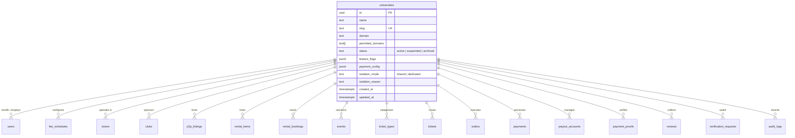
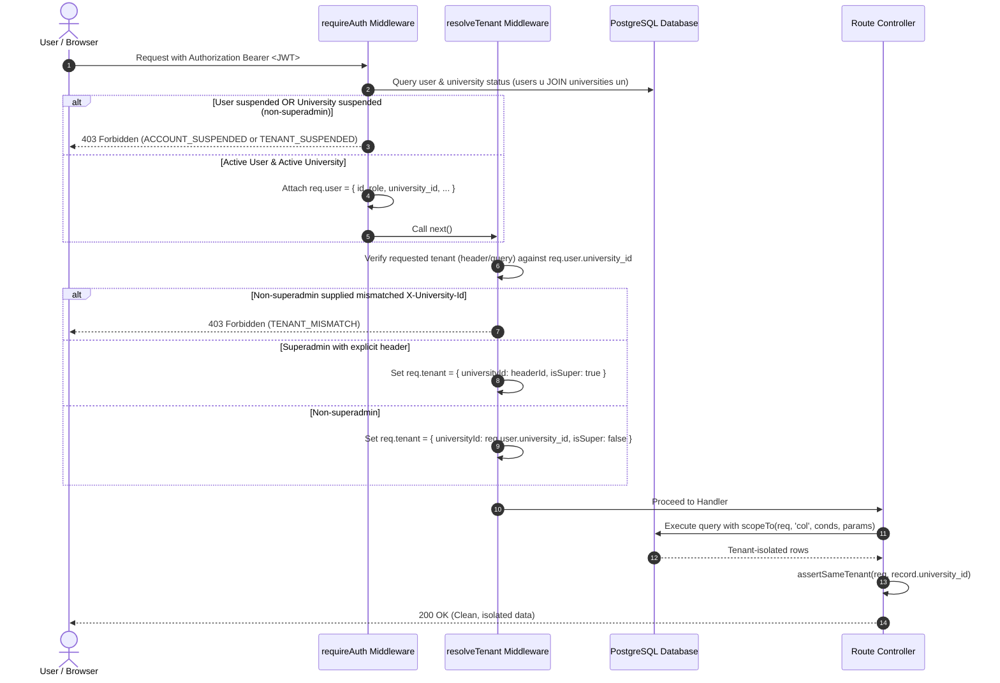
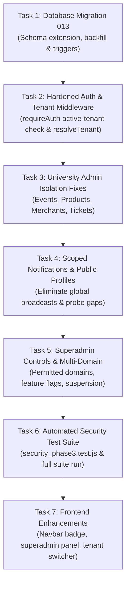

# CAMPUSHUB — PHASE 3: MULTI-TENANT ARCHITECTURE & TENANT ISOLATION
## Production-Grade Architecture, Security Model & Implementation Plan

---

### 1. Executive Summary

CampusHub was initially built and validated for Addis Ababa Science and Technology University (AASTU). Phases 1 and 2 established hardened payments (Chapa HMAC-SHA256, verification callbacks, mock bypass prevention), email OTP verification, secure file uploads (magic-byte validation and sharp re-encoding), password resets, and HttpOnly cookie sessions with CSRF protection, passing all 60 automated security regression tests.

The goal of **Phase 3** is to transition CampusHub from an AASTU-centric deployment into an enterprise-grade, shared-schema **multi-tenant platform** capable of hosting multiple universities (AASTU, Addis Ababa University, Bahir Dar University, Hawassa University, and future institutions) with **strict logical isolation**.

#### Core Security Guarantee
Under no circumstances may a student, merchant, club organizer, or university administrator belonging to University $A$ view, modify, or tamper with private marketplace listings, orders, payments, rental bookings, disputes, event tickets, verification documents, or user records belonging to University $B$.

#### Key Architectural Pillars
1. **Zero-Trust Client Identity for Tenancy:** An authenticated user's tenant context is derived **exclusively** from server-side trusted database records (`users.university_id`), never from client-provided headers, query parameters, body payloads, or local storage.
2. **Fail-Closed Authorization:** Every endpoint reading or modifying resources enforces tenant boundary checks at the database query layer (`scopeTo`), the object retrieval layer (`assertSameTenant`), and the authentication middleware (`requireAuth` verifying active university status). Ambiguous or missing tenant context safely aborts the request.
3. **Complete Tenant Schema Coverage:** Denormalize `university_id` onto all remaining child/operational tables (`rental_bookings`, `tickets`, `ticket_types`, `reviews`, `payout_accounts`, `payment_proofs`), enforce foreign keys to `universities(id)`, and attach database triggers (`cn_set_university_id()`) so tenant identity is immutable and automatically preserved on insertion.
4. **Platform Superadmin vs. University Admin Separation:** University administrators are strictly bounded to their assigned university. Platform superadmins manage university onboarding, feature flags, fee schedules, and global policies with mandatory audit trails for every cross-tenant mutation.
5. **Preservation of Existing Security Controls:** All 60 Phase 1 & 2 automated security tests remain active and passing throughout the entire Phase 3 evolution.

---

### 2. Existing Architecture and Current Tenant-Related Capabilities

A comprehensive code inspection of `C:\CampusHub` reveals that early architectural groundwork for multi-tenancy was partially drafted in `backend/db/migrations/003_phase3_multitenancy.sql` and `004_phase2_tenancy.sql`, along with `backend/src/middleware/tenant.js` and `backend/src/modules/super/routes.js`.

#### Current Capabilities
1. **Universities Table:**
   - Exists in PostgreSQL with columns `id`, `name`, `domain`, `status`, `created_at`, `slug`, `feature_flags`, `isolation_mode`, `isolation_reason`, `updated_at`.
   - Single AASTU tenant exists with domain `aastu.edu.et`.
2. **User Affiliation:**
   - `users.university_id` foreign key references `universities(id) ON DELETE RESTRICT`.
   - Check constraint `users_tenant_required_chk` requires non-superadmins to have a non-null `university_id`.
   - Role enum includes `'student'`, `'merchant'`, `'organizer'`, `'admin'`, `'super_admin'`.
3. **Tenant Middleware (`src/middleware/tenant.js`):**
   - Implements `resolveTenant()`, setting `req.tenant = { universityId, isSuper, university }`.
   - Implements `scopeTo(req, column, conditions, params)` for tenant-bound SQL queries.
   - Implements `assertSameTenant(req, rowUniversityId, what)` throwing 404 on mismatch.
   - Implements `requireFeature(flag)` reading `req.tenant.university.feature_flags[flag]`.
4. **Platform Superadmin API (`src/modules/super/routes.js`):**
   - Endpoints for `POST /api/super/universities` (atomic onboarding of university, admin, and initial clubs), `PATCH /api/super/universities/:id`, fee schedules, and cross-university KPI rollups.
5. **Partial Trigger Coverage (`cn_set_university_id()`):**
   - Derives `university_id` on INSERT for `stores`, `merchant_applications`, `p2p_listings`, `rental_items`, `orders`, `events`, `payments`, `reports`, `disputes`, `audit_logs`, `p2p_orders`, and `waitlist_entries`.

---

### 3. Current Security Gaps and Confirmed Risks

Despite the early tenancy scaffolding, our deep line-by-line audit identified **critical security vulnerabilities and isolation gaps** in the active codebase:

#### Confirmed Gap 1: Unscoped University Admin Routes (Privilege Escalation & Cross-Tenant Modification)
* **`PATCH /api/events/:id/admin-decision` (`src/modules/events/routes.js` L206-220):**
  Uses `requireRole("admin")`, fetches event by `id`, and sets approval status without checking `event.university_id === req.user.university_id`. A university administrator from University $A$ can approve or reject events from University $B$.
* **`PATCH /api/events/:id` (`src/modules/events/routes.js` L160-170):**
  Allows any user with `role === 'admin'` to modify or cancel an event without verifying university ownership.
* **`POST /api/tickets/:id/verify` (`src/modules/tickets/routes.js` L122-126):**
  In `verifyOneTicket`, while organizers are checked against club ownership, admins bypass club checks without verifying `event.university_id === scannerUser.university_id`. An admin of University $A$ can admit attendees into University $B$'s events.
* **`GET /api/merchants/:storeId/analytics` (`src/modules/merchants/routes.js` L177-184):**
### 3. Current Security Gaps and Verified Risks

Our deep line-by-line codebase and live database schema audit revalidated all tenant isolation points. Below, findings are strictly distinguished into Confirmed Vulnerabilities, Potential Vulnerabilities Requiring Further Investigation, and Existing Protections That Already Address An Issue.

#### A. Confirmed Vulnerabilities

1. **Unscoped University Admin Actions (Privilege Escalation & Cross-Tenant Modification):**
   * **`PATCH /api/events/:id/admin-decision` (`src/modules/events/routes.js` L206-220):**
     Uses `requireRole("admin")`, fetches event by `id`, and sets approval status without checking `event.university_id === req.user.university_id` (missing `assertSameTenant`). A university administrator from University $A$ can approve or reject events from University $B$.
   * **`PATCH /api/events/:id` (`src/modules/events/routes.js` L160-170):**
     Allows any user with `role === 'admin'` to modify or cancel an event without verifying university ownership.
   * **`POST /api/tickets/:id/verify` (`src/modules/tickets/routes.js` L122-126):**
     In `verifyOneTicket`, while organizers are checked against club ownership, admins bypass club checks without verifying `event.university_id === scannerUser.university_id`. An admin of University $A$ can admit attendees into University $B$'s events.
   * **`GET /api/merchants/:storeId/analytics` (`src/modules/merchants/routes.js` L177-184):**
     Checks `if (req.user.role !== "admin" && store.merchant_id !== req.user.id) throw forbidden();`. Does not verify store university ownership. An admin of University $A$ can view total revenues and sales figures of any store in University $B$.
   * **`PATCH /api/products/:id` & `DELETE /api/products/:id` (`src/modules/products/routes.js` L124-168):**
     Guarded by `requireRole("merchant", "admin")`. If the caller is `admin`, the merchant ownership check is skipped and store university affiliation is never verified. An admin from University $A$ can modify or delete store products in University $B$.

2. **Cross-Tenant Information Leaks via Global Admin Notifications:**
   * **`POST /api/events/:id/submit` (`src/modules/events/routes.js` L141):**
     Queries `SELECT id FROM users WHERE role='admin'` without scoping to `university_id`, notifying ALL platform admins across all universities when an event is submitted.
   * **`POST /api/merchants/apply` (`src/modules/merchants/routes.js` L38):**
     Broadcasts notifications to all platform administrators regardless of university.
   * **`POST /api/reports` (`src/modules/reports/routes.js` L27):**
     Broadcasts reports to all administrators across all universities.

3. **Authentication Middleware Fails Open on Suspended Universities:**
   * **`requireAuth()` (`src/middleware/auth.js` L8-32):**
     Checks `user.suspended` and `user.email_verified`, but **never** validates that `user.university_id` points to an `active` university.
   * Routes that mount `requireAuth()` without running `resolveTenant()` (e.g., `/api/auth/refresh`, `/api/users/me`, `/api/users/me/password`, `/api/users/me/stats`, `/api/users/me/activity`) allow users from a suspended university to continue active sessions and operations indefinitely.

4. **Missing Tenant Identification on Operational Tables:**
   * **`rental_bookings`:** Has NO `university_id` column. Lookups on `GET /api/rentals/bookings/mine`, `loadBookingWithItem`, pickup, return, and dispute handling rely solely on `user_id` without explicit tenant ownership.
   * **`tickets` & `ticket_types`:** Have NO `university_id` column.
   * **`reviews`:** Has NO `university_id` column. Reviews on stores, products, listings, and users are completely un-scoped by tenant.
   * **`payment_proofs` & `payout_accounts`:** Migration 005 added `university_id`, but the database trigger `cn_set_university_id()` was never registered for these tables, leaving them vulnerable to null or inconsistent tenant data.

5. **Single Domain Limitation in Universities Table:**
   * `universities.domain` is a single `TEXT` column (e.g. `aastu.edu.et`). Many institutions utilize multiple domains (e.g., student vs. faculty: `student.aastu.edu.et` vs `aastu.edu.et`). Restricting universities to a single domain prevents legitimate student registration.

#### B. Potential Vulnerabilities Requiring Further Investigation

1. **Public Profile User Intelligence Gathering:**
   * **`GET /api/users/:id/public` (`src/modules/auth/users.routes.js` L446-557):**
     Allows unauthenticated lookup of user profiles by UUID. While marketplace sellers and club organizers intentionally display public profiles, students' academic details (department, year) should be protected from cross-campus harvesting.
2. **Global Taxonomy vs Tenant Catalogs:**
   * The `categories` table is shared globally. This is safe and standard for common marketplace categories, but must be monitored to ensure tenant-specific categories do not leak across universities in the future.
3. **Superadmin Scoped Audit Trail:**
   * When a superadmin acts inside a specific tenant (`X-University-Id`), their actions currently record `actor_id` (who has `university_id = NULL`). Audit log entries must be verified to ensure `target_type` and `details.universityId` capture the tenant context.

#### C. Existing Protections That Already Address An Issue

1. **Client Tenant Header Tampering for Non-Superadmins:**
   * In `resolveTenant()` (`src/middleware/tenant.js` L50-64), if an authenticated non-superadmin passes `X-University-Id` or `?universityId` that differs from their `user.university_id`, the request is already rejected with HTTP 403 `TENANT_MISMATCH`.
2. **Order and Marketplace Record Ownership:**
   * `orders` and `stores` already have `university_id` columns, foreign keys to `universities(id)`, and automatic derivation via `trg_orders_tenant`. `loadOrder()` in `orders/routes.js` already verifies `assertSameTenant()`.
3. **Chapa Webhook Tenant Verification:**
   * In `processChapaWebhook()` (`src/services/payments.js`), payment lookup is executed by `cleanTxRef` (the payment UUID) using row-level locking. The tenant context is read from the trusted database row (`payment.university_id`), ignoring any tenant claims in the webhook payload.
4. **Verification Document Privacy:**
   * Verification documents are stored in `/private_uploads/proofs/` and are never served statically. Retrieval endpoints (`/api/verifications/me/requests/:id/document` and `/api/admin/verifications/requests/:id/document`) already enforce user ownership and `assertSameTenant()`.

---

### 4. Proposed Database Schema and Relationships

To achieve airtight data isolation and performance, the database schema will be enhanced via migration `013_multitenant_isolation.sql`.



#### Detailed Column Enhancements:
1. **`universities` Table:**
   - `permitted_domains TEXT[] NOT NULL DEFAULT '{}'`: Array of permitted email domains (e.g. `['aastu.edu.et', 'student.aastu.edu.et']`).
   - `payment_config JSONB NOT NULL DEFAULT '{"allowed_providers": ["mock", "chapa", "manual"]}'`: Configures permitted payment methods per university.
   - Status check: `CHECK (status IN ('active', 'suspended', 'archived'))`.
2. **Denormalized `university_id` on Operational Tables:**
   - `ALTER TABLE rental_bookings ADD COLUMN IF NOT EXISTS university_id UUID REFERENCES universities(id);`
   - `ALTER TABLE tickets ADD COLUMN IF NOT EXISTS university_id UUID REFERENCES universities(id);`
   - `ALTER TABLE ticket_types ADD COLUMN IF NOT EXISTS university_id UUID REFERENCES universities(id);`
   - `ALTER TABLE reviews ADD COLUMN IF NOT EXISTS university_id UUID REFERENCES universities(id);`
3. **Trigger Coverage Expansion:**
   - Update `cn_set_university_id()` to derive `university_id` for:
     - `rental_bookings` $\leftarrow$ `rental_items.university_id`
     - `ticket_types` $\leftarrow$ `events.university_id`
     - `tickets` $\leftarrow$ `events.university_id`
     - `payout_accounts` $\leftarrow$ `users.university_id`
     - `payment_proofs` $\leftarrow$ `payments.university_id`
     - `reviews` $\leftarrow$ derived from target entity (`products`, `stores`, `p2p_listings`, or `users`).
4. **Performance & Query Optimization Indexes:**
   - `CREATE INDEX idx_rental_bookings_tenant ON rental_bookings(university_id, status);`
   - `CREATE INDEX idx_tickets_tenant ON tickets(university_id, status);`
   - `CREATE INDEX idx_ticket_types_tenant ON ticket_types(university_id);`
   - `CREATE INDEX idx_reviews_tenant ON reviews(university_id, target_type);`
   - `CREATE INDEX idx_payout_accounts_tenant ON payout_accounts(university_id);`
   - `CREATE INDEX idx_payment_proofs_tenant ON payment_proofs(university_id);`

---

### 5. Proposed Tenant-Context and Authorization Design



#### Authorization Rules:
1. **Authenticated Non-Superadmin (Students, Merchants, Organizers, University Admins):**
   - Tenant context is **immutable** and locked to `req.user.university_id`.
   - Any client attempt to pass a conflicting `X-University-Id`, `X-University-Slug`, or `?universityId=` is rejected with HTTP 403 `TENANT_MISMATCH`.
2. **Platform Superadmin (`super_admin`):**
   - If `X-University-Id` or `X-University-Slug` is present: operations are scoped to that university.
   - If omitted: operations operate cross-tenant (e.g. global university list, comparative KPIs).
   - All superadmin mutations generate structured audit records.
3. **Unauthenticated Public Browsing:**
   - Client specifies tenant via `X-University-Id`, `X-University-Slug`, or `?universityId=`.
   - If exactly one active university exists in the platform, defaults to that university (guaranteeing single-campus backward compatibility).
   - If two or more active universities exist and no tenant is supplied, public browse endpoints return HTTP 400 `TENANT_REQUIRED`.
4. **PostgreSQL Row-Level Security (RLS) Strategy:**
   - Connection model: Node.js utilizes connection pooling (`pg.Pool`).
   - RLS policies must rely on transaction-local session settings (`SET LOCAL app.current_tenant = ...`) within `db.withTransaction`.
   - Application-level scoping via `scopeTo()` and `assertSameTenant()` remains the **primary** line of defense; RLS will be deployed in audit/enforce mode to prevent raw query bypasses without degrading connection pool recycling.

---

### 6. Existing Tables That Need Tenant Relationships

The following table inventory defines the exact tenant relationship mechanism for all 24 tables:

| Table Name | Has `university_id` Column? | Needs Migration? | Trigger Coverage | Derivation Logic |
| :--- | :--- | :--- | :--- | :--- |
| `universities` | PK (`id`) | No (Add columns) | N/A | Base Tenant Table |
| `users` | Yes (`university_id`) | No (Already exists) | N/A | Direct Assignment on Signup / Provisioning |
| `stores` | Yes (`university_id`) | No | Existing | Derived from `users.university_id` |
| `merchant_applications` | Yes (`university_id`) | No | Existing | Derived from `users.university_id` |
| `products` | Indirect via `store_id` | Optional (Direct) | Via `stores` | Scoped via `s.university_id` |
| `orders` | Yes (`university_id`) | No | Existing | Derived from `stores.university_id` |
| `order_items` | Indirect via `order_id` | No | Via `orders` | Inherits from parent `orders` |
| `p2p_listings` | Yes (`university_id`) | No | Existing | Derived from `users.university_id` |
| `p2p_requests` | Indirect via `listing_id` | No | Via `p2p_listings`| Inherits from parent `p2p_listings` |
| `p2p_orders` | Yes (`university_id`) | No | Existing | Derived from `p2p_listings.university_id` |
| `rental_items` | Yes (`university_id`) | No | Existing | Derived from `users.university_id` |
| `rental_bookings` | **NO** | **YES (Add Column)** | **Add Trigger** | Derived from `rental_items.university_id` |
| `disputes` | Yes (`university_id`) | No | Existing | Derived from `rental_items.university_id` |
| `clubs` | Yes (`university_id`) | No | Explicit | Explicit on Creation (`NOT NULL`) |
| `events` | Yes (`university_id`) | No | Existing | Derived from `clubs.university_id` |
| `ticket_types` | **NO** | **YES (Add Column)** | **Add Trigger** | Derived from `events.university_id` |
| `tickets` | **NO** | **YES (Add Column)** | **Add Trigger** | Derived from `events.university_id` |
| `waitlist_entries` | Yes (`university_id`) | No | Existing | Derived from `events.university_id` |
| `reviews` | **NO** | **YES (Add Column)** | **Add Trigger** | Derived from target entity `university_id` |
| `reports` | Yes (`university_id`) | No | Existing | Derived from `users.university_id` |
| `notifications` | Indirect via `user_id` | Optional | User-scoped | Strictly bounded to `user_id = req.user.id` |
| `payments` | Yes (`university_id`) | No | Existing | Derived from underlying transaction entity |
| `payout_accounts` | Yes (`university_id`) | No | **Add Trigger** | Derived from `users.university_id` |
| `payment_proofs` | Yes (`university_id`) | No | **Add Trigger** | Derived from `payments.university_id` |
| `verification_requests` | Yes (`university_id`) | No | Existing | Explicit from `users.university_id` |
| `audit_logs` | Yes (`university_id`) | No | Existing | Derived from `actor.university_id` |

---

### 7. Migration and AASTU Data-Backfill Strategy

Migration script: `backend/db/migrations/013_multitenant_isolation.sql`

#### Idempotent Execution Flow
1. **Identify Anchor Tenant:**
   ```sql
   DO $$
   DECLARE aastu_id UUID;
   BEGIN
     SELECT id INTO aastu_id FROM universities WHERE domain = 'aastu.edu.et' OR slug = 'addis-ababa-science-and-technology-university' LIMIT 1;
     IF aastu_id IS NULL THEN
       SELECT id INTO aastu_id FROM universities ORDER BY created_at ASC LIMIT 1;
     END IF;
     IF aastu_id IS NULL THEN
       INSERT INTO universities (name, domain, slug, status)
       VALUES ('Addis Ababa Science and Technology University', 'aastu.edu.et', 'aastu', 'active')
       RETURNING id INTO aastu_id;
     END IF;
   ```
2. **Backfill Tenant Columns:**
   - Update `rental_bookings` where `university_id IS NULL` using `rental_items.university_id`.
   - Update `ticket_types` where `university_id IS NULL` using `events.university_id`.
   - Update `tickets` where `university_id IS NULL` using `events.university_id`.
   - Update `payout_accounts` where `university_id IS NULL` using `users.university_id`.
   - Update `payment_proofs` where `university_id IS NULL` using `payments.university_id`.
   - Update `reviews` where `university_id IS NULL` using target records (stores/products/listings/users).
   - If any orphan row remains without an owner, assign to `aastu_id`.
3. **Attach Extended Triggers:**
   - Attach `cn_set_university_id()` to `rental_bookings`, `ticket_types`, `tickets`, `payout_accounts`, `payment_proofs`, and `reviews`.
4. **Enforce Constraints:**
   - Set foreign keys to `universities(id) ON DELETE RESTRICT`.
   - Safe validation using `NOT VALID` followed by `VALIDATE CONSTRAINT` to prevent lock contention on active tables.

---

### 8. Required Backend Changes, Organized by Exact File Path

#### 1. `backend/src/middleware/auth.js`
* **Why Necessary:** Currently `requireAuth()` does not check if the user's university is active. A suspended university's users can still call routes that don't execute `resolveTenant`.
* **Changes:**
  - Join `universities un ON un.id = u.university_id`.
  - If `u.role !== 'super_admin'`, verify `un.status === 'active'`. If suspended or inactive, throw HTTP 403 `TENANT_SUSPENDED`.

#### 2. `backend/src/middleware/tenant.js`
* **Why Necessary:** Ensure consistent fail-closed behavior across all routes, enforce strict superadmin vs. admin context switching, and validate slug/id conversions.
* **Changes:**
  - Standardize `assertSameTenant` to compare directly against `req.tenant.universityId`.
  - Refine `requireFeature` to fail closed if university context is missing.

#### 3. `backend/src/modules/events/routes.js`
* **Why Necessary:** Eliminate cross-tenant admin event manipulation and global broadcast leaks.
* **Changes:**
  - In `PATCH /:id/admin-decision`: Add `assertSameTenant(req, event.university_id, "Event")`.
  - In `PATCH /:id`: Verify that if caller is `admin`, `event.university_id === req.user.university_id`.
  - In `POST /:id/submit`: Scope admin notification to `WHERE role='admin' AND university_id = $1`.

#### 4. `backend/src/modules/tickets/routes.js`
* **Why Necessary:** Prevent cross-tenant ticket verification / scanning by university admins.
* **Changes:**
  - In `verifyOneTicket`: If `scannerUser.role === 'admin'`, verify `ticket.university_id === scannerUser.university_id` (or `event.university_id`). Reject with 403 `FORBIDDEN` if mismatch.

#### 5. `backend/src/modules/merchants/routes.js`
* **Why Necessary:** Block cross-tenant store analytics snooping and restrict merchant application notifications.
* **Changes:**
  - In `POST /apply`: Scope admin notification query to `WHERE role='admin' AND university_id = $1`.
  - In `GET /:storeId/analytics`: Add `assertSameTenant(req, store.university_id, "Store")` and ensure `admin` can only view stores within their own university.

#### 6. `backend/src/modules/products/routes.js`
* **Why Necessary:** Prevent university admins from modifying or soft-deleting products belonging to stores of another university.
* **Changes:**
  - In `PATCH /:id` and `DELETE /:id`: If `req.user.role === 'admin'`, verify `existing.store_id` belongs to a store where `store.university_id === req.user.university_id`.

#### 7. `backend/src/modules/reports/routes.js`
* **Why Necessary:** Prevent global admin notification broadcasts on report submissions.
* **Changes:**
  - Scope admin notification query to `WHERE role='admin' AND university_id = $1` using `req.user.university_id`.

#### 8. `backend/src/modules/rentals/routes.js`
* **Why Necessary:** Ensure rental bookings enforce tenant boundaries on retrieval and action endpoints (`pickup`, `return`, `dispute`).
* **Changes:**
  - Include `ri.university_id` in `loadBookingWithItem` and invoke `assertSameTenant(req, booking.university_id, "Rental booking")`.

#### 9. `backend/src/modules/auth/routes.js`
* **Why Necessary:** Multi-domain support per university during registration.
* **Changes:**
  - Match user email against `universities.permitted_domains` array as well as primary `domain`.

#### 10. `backend/src/modules/auth/users.routes.js`
* **Why Necessary:** Scope public user profiles to protect against cross-tenant user intelligence gathering.
* **Changes:**
  - In `GET /:id/public`: Enforce optional tenant scoping or return university badges; restrict private activity history to the requested tenant context.

#### 11. `backend/src/modules/super/routes.js`
* **Why Necessary:** University management, multi-domain configuration, university suspension, and tenant payment configuration.
* **Changes:**
  - Add `permittedDomains` and `paymentConfig` to `POST /universities` and `PATCH /universities/:id`.
  - Add explicit audit logging for university suspension/activation.

#### 12. `backend/src/app.js`
* **Why Necessary:** Ensure consistent route mounting and error handling across tenant boundaries.

---

### 9. Required Frontend Changes, Organized by Exact File Path

#### 1. `frontend/src/context/AuthContext.jsx`
* **Why Necessary:** Store and expose the authenticated user's university metadata (`user.university_id`, `user.university_name`) and support superadmin active-tenant selection.
* **Changes:**
  - Expose `activeUniversityId`, `setActiveUniversityId` (for superadmins).
  - Synchronize active university context with API client headers.

#### 2. `frontend/src/api/client.js`
* **Why Necessary:** Automatically attach `X-University-Id` when browsing unauthenticated or when a superadmin switches tenant view.
* **Changes:**
  - Add request interceptor to attach `X-University-Id` if set in memory/session.

#### 3. `frontend/src/components/Navbar.jsx`
* **Why Necessary:** Surface the user's university context in the top navigation bar and provide superadmins with a quick tenant-switcher pill.
* **Changes:**
  - Render university badge next to user profile.
  - Render a tenant switcher dropdown for `super_admin`.

#### 4. `frontend/src/pages/Register.jsx`
* **Why Necessary:** Ensure accurate university selection and auto-verification messaging based on multi-domain configuration.
* **Changes:**
  - Fetch available active universities from `/api/meta/universities`.
  - Provide domain matching hint.

#### 5. `frontend/src/pages/Admin.jsx`
* **Why Necessary:** Clarify university scope in the administration dashboard so university admins clearly see they are managing their specific campus.
* **Changes:**
  - Display active campus title (`Administering ${universityName}`).

#### 6. `frontend/src/pages/SuperAdmin.jsx` (New Component)
* **Why Necessary:** Dedicated platform administration dashboard for platform superadmins.
* **Changes:**
  - Manage universities (create, suspend, configure domains, set feature flags).
  - Assign university administrators.
  - Review cross-campus analytics.

---

### 10. Payment-Provider Configuration Approach

1. **Isolation of Secrets:**
   - Platform credentials (`CHAPA_SECRET_KEY`, `CHAPA_WEBHOOK_SECRET`) remain platform-wide secrets managed exclusively in environment variables or vault storage.
   - University administrators **never** have access to view or configure platform-level secrets.
2. **University-Level Payment Capabilities:**
   - Each university has a `payment_config` JSONB column in `universities`:
     ```json
     {
       "enabled_providers": ["mock", "chapa", "manual"],
       "chapa_subaccount": null,
       "manual_payment_enabled": true
     }
     ```
   - Superadmins configure permitted payment options per university via `/api/super/universities/:id`.
3. **Webhook Tenant Determination:**
   - In `processChapaWebhook` (`src/services/payments.js`), the payment is fetched by `id = cleanTxRef` using row locking.
   - The associated university is derived **directly from the trusted database row** (`payment.university_id`), completely immune to tenant spoofing in the webhook payload.

---

### 11. Feature-Flag Approach

1. **Database-Backed Flags:**
   - Stored in `universities.feature_flags` as a JSONB dictionary (e.g. `{"p2p": true, "rentals": true, "events": false}`).
2. **Safe Defaults (Fail Open for Existing Tenants):**
   - In `requireFeature(flag)` (`src/middleware/tenant.js`), if a flag is omitted or `null`, it defaults to `true`. This ensures AASTU and existing operations never break.
3. **Server-Side Enforcement:**
   - Mounted directly on route groups in `app.js`:
     ```javascript
     app.use("/api/listings", tenant, requireFeature("p2p"), ...);
     app.use("/api/rentals", tenant, requireFeature("rentals"), ...);
     app.use("/api/events", tenant, requireFeature("events"), ...);
     ```
   - Calling a disabled feature returns HTTP 403 `FEATURE_DISABLED`.

---

### 12. Analytics and Audit Logging

1. **University-Scoped Analytics (`/api/admin/analytics`):**
   - Strictly parameterized by `req.tenant.universityId`.
   - University admins only receive statistics for their assigned university (user count, active merchants, order volumes, revenue).
2. **Cross-Campus Comparative Analytics (`/api/super/analytics/compare`):**
   - Restricted to `super_admin` only.
   - Aggregates KPIs across all universities for platform monitoring.
3. **Structured Audit Trail (`audit_logs` table):**
   - Includes `university_id`, `actor_id`, `action`, `target_type`, `target_id`, `details`, and `created_at`.
   - Sensitive actions audited:
     - `university.onboard`, `university.update`, `university.suspend`
     - `admin.promote`, `admin.demote`
     - `fee_schedule.create`
     - `verification.approve`, `verification.reject`
     - `merchant.decision`
     - `payment.refund`
   - **Zero Secret Logging:** Passwords, tokens, OTPs, card numbers, and secret keys are strictly scrubbed before audit logging.

---

### 13. Automated Security Test Plan

A dedicated test suite `backend/test/security_phase3.test.js` will be created using the Node.js native test runner (`node:test` and `node:assert`), matching the exact testing pattern of Phases 1 and 2.

#### Test Cases (25+ Scenarios):
1. **Tenant Identification & Enforcement:**
   - Reject conflicting `X-University-Id` header for authenticated student (403 `TENANT_MISMATCH`).
   - Derive tenant context strictly from authenticated user record.
   - Reject unauthenticated requests to multi-tenant platform when no tenant is specified (400 `TENANT_REQUIRED`).
2. **Cross-Tenant Data Isolation (IDOR Prevention):**
   - University $B$ student cannot read University $A$ order by ID (404 `NOT_FOUND`).
   - University $B$ student cannot read University $A$ rental booking by ID (404 `NOT_FOUND`).
   - University $B$ student cannot buy ticket for University $A$ event (404 `NOT_FOUND`).
   - University $B$ student cannot order products from University $A$ store (404 `NOT_FOUND`).
3. **Cross-Tenant University Admin Isolation:**
   - University $B$ admin cannot view University $A$ users (scoped list).
   - University $B$ admin cannot view University $A$ pending verifications or documents (404 `NOT_FOUND`).
   - University $B$ admin cannot approve/reject University $A$ event (404 `NOT_FOUND`).
   - University $B$ admin cannot view University $A$ merchant store sales analytics (404/403).
   - University $B$ admin cannot modify or delete University $A$ product (404/403).
   - University $B$ admin cannot verify/scan tickets for University $A$ event (403 `FORBIDDEN`).
4. **Platform Superadmin Operations:**
   - Superadmin can onboard a new university atomically with admin and initial club.
   - Superadmin can toggle university feature flags and fee schedules.
   - Superadmin can view scoped single-tenant view with header and cross-tenant view without header.
   - Non-superadmin attempting `/api/super/*` is rejected with 403 `FORBIDDEN`.
5. **University Suspension:**
   - Suspending a university immediately blocks login and token refresh for its users (403 `TENANT_SUSPENDED`).
   - Suspending a university blocks public access to its marketplace and listings.
6. **Feature Flag Enforcement:**
   - Disabling `rentals` flag on a university causes `/api/rentals` to return 403 `FEATURE_DISABLED`.
7. **Regression Guard:**
   - Phase 1 payment & OTP tests pass 100% (33 tests).
   - Phase 2 upload, password-reset, cookie & CSRF tests pass 100% (27 tests).

---

### 14. Backward-Compatibility Risks

1. **Single-Campus Legacy Compatibility:**
   - When only AASTU is present, unauthenticated browse continues to work without requiring client header changes.
2. **Database Triggers:**
   - Because `cn_set_university_id()` auto-populates `university_id` on INSERT, existing application code and tests that omit `university_id` on entity creation will continue to function seamlessly.
3. **Preserving Active Sessions:**
   - Backfilling ensures all existing users, stores, orders, and listings maintain continuous valid associations with AASTU.

---

### 15. Implementation Sequence with Small, Reviewable Tasks



* **Step 1:** Create and execute migration `013_multitenant_isolation.sql` to extend schema, backfill AASTU data, and attach triggers.
* **Step 2:** Harden `requireAuth` and `resolveTenant` middleware to fail closed on suspended universities and header mismatches.
* **Step 3:** Patch route handlers in `events`, `tickets`, `merchants`, and `products` to eliminate cross-tenant admin bypasses.
* **Step 4:** Scope admin notification broadcasts to the actor's university and secure public user profiles.
* **Step 5:** Enhance superadmin onboarding to support multi-domain email matching and per-university payment configuration.
* **Step 6:** Author and execute `security_phase3.test.js`, confirming all Phase 1, 2, and 3 security tests pass.
* **Step 7:** Update frontend components for university display and superadmin administration.

---

### 16. Acceptance Criteria

1. **Strict Data Isolation:** Zero cross-tenant data leakage or unauthorized mutation across any endpoint in the API.
2. **Server-Side Authority:** Tenant context derived strictly from authenticated user state; forged headers rejected.
3. **Admin Containment:** University administrators are strictly confined to their own university's users, stores, events, and reports.
4. **Complete Schema Denormalization:** All tenant-owned tables have foreign keys to `universities(id)` and automatic trigger propagation.
5. **Full Test Suite Success:** 60 existing security tests + 25+ Phase 3 multi-tenancy tests pass 100% with zero regressions.

---

### 17. Estimated Complexity and Dependencies

* **Estimated Complexity:** Medium-High (High security sensitivity, database constraints, and multi-module routing).
* **Dependencies:**
  - PostgreSQL 14+ with `pgcrypto` extension (active in local database).
  - Node.js 18+ with `express`, `pg`, `zod`.
  - No new external runtime dependencies required.
